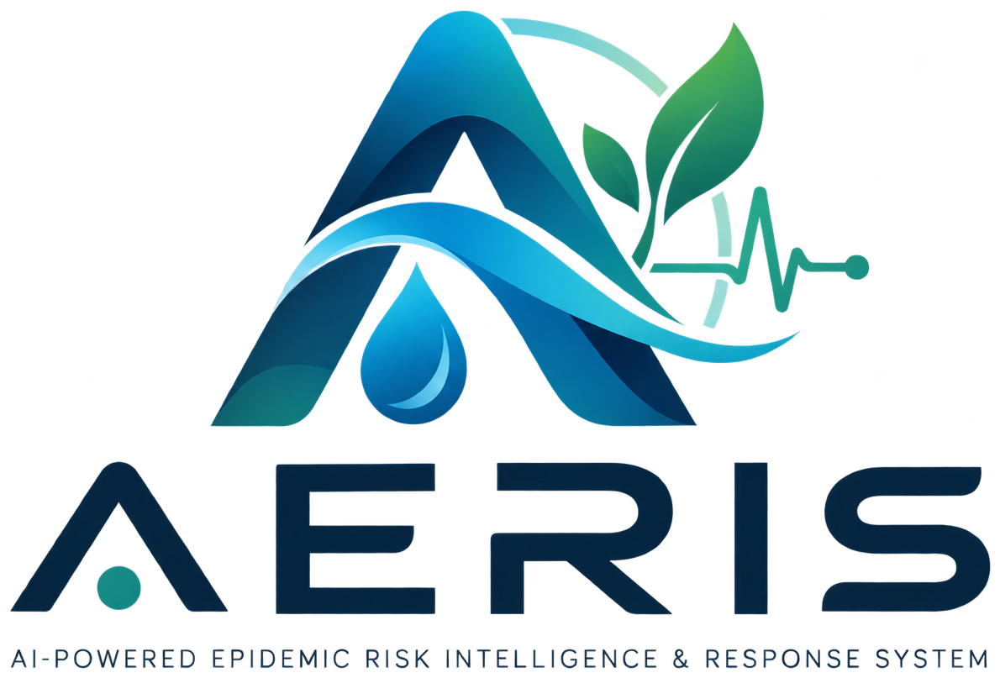

# AERIS — AI-Powered Epidemic Risk Intelligence System

<p align="center">
  
</p>

<p align="center">
  <strong>Early Warning Surveillance for Water-Borne Outbreaks in Rural Northeast India</strong><br>
  <em>Automated Epidemic Risk Intelligence & Surveillance Platform</em><br>
  <strong>"A risk signal is a prompt to verify, not a confirmed outbreak."</strong>
</p>

<p align="center">
  
  
  
  
  
</p>

---

## 🌟 Executive Summary

**AERIS** (Automated Epidemic Risk Intelligence & Surveillance) is a production-grade public health platform engineered to detect water-borne disease outbreaks (Cholera, Acute Diarrhoea, Enteric Fever, AES) **3 to 5 days before clinical hospital registers peak**.

Built specifically for the complex hydrology and terrain of **Northeast India** (Assam, Meghalaya, Tripura, Manipur, Arunachal Pradesh, Nagaland, Mizoram, Sikkim), AERIS combines:
1. **Authoritative Deterministic Clinical Rules** for reliable rapid action.
2. **Calibrated Scikit-Learn Machine Learning** for probabilistic trend intelligence.
3. **Mathematical Anti-Fake Verification** (Dihedral D5 Verhoeff checksums, salted SHA-256 ID hashing, and 15 km GPS Haversine validation).
4. **Offline-First PWA** for frontline ASHA workers in remote low-connectivity riverine and hill tracts.
5. **Interactive 3D MapLibre GL Visualizations** with 8-state polygon overlays, flood zones, and temporal playback.

---

## 🎨 Official Sentinel Color Palette

Designed exclusively with the palette specified in `reference/Screenshot 2026-10-21 235300.png`:

| Swatch | Hex Code | Role in AERIS |
|---|---|---|
| **Forest** | `#102F15` | App frame, sidebar, headers, primary typography |
| **Emerald** | `#339966` | Primary action buttons, active navigation, Low-risk indicator |
| **Mint** | `#66CC99` | Secondary accents, metric cards, charts |
| **Soft Mint** | `#D3FEEA` | Selected items, highlight containers, card fills |
| **Pale Green** | `#EBFADC` | Page backgrounds, dashboard canvas |
| **Pale Lime** | `#EAF1B1` | Environmental badges, telemetry callouts |
| **White** | `#FFFFFF` | Card surfaces and elevation containers |

---

## 🚀 Quick Start (One Command)

### Windows
Double-click `run_aeris.bat` or run:
```cmd
run_aeris.bat
```

### Linux / macOS
```bash
chmod +x run_aeris.sh
./run_aeris.sh
```

### Docker Compose
```bash
docker-compose up --build
```

The system will automatically initialize the database, seed 47 villages across all 8 NE states, start both FastAPI (port 8000) and React (port 5173), and launch your browser.

---

## 🔑 Quick Access Test Accounts

| Role | Email Identifier | Phone | Password | Access Level |
|---|---|---|---|---|
| **Super Admin** | `admin@sentinel.org` | `+919876543213` | `Sentinel@123` | Full Mission Control, User Verification, Sandbox |
| **Health Officer** | `officer@sentinel.org` | `+919876543212` | `Sentinel@123` | District Management, Alert Resolution, Field Dispatch |
| **ASHA Worker** | `asha@sentinel.org` | `+919876543211` | `Sentinel@123` | Priority Verified Field Reporting, Offline Queue |
| **Civilian** | `civilian@sentinel.org` | `+919876543210` | `Sentinel@123` | Citizen Syndromic Reporting, Advisory Access |

*(Quick-login buttons for all roles are available in the Auth Modal for instant evaluation).*

---

## 🏗️ Architecture & Technical Stack

```
aeris-2.0/
├── apps/
│   ├── api/                    # FastAPI Backend
│   │   ├── app/
│   │   │   ├── core/           # Security, Verhoeff D5, ID Hashing, WebSocket
│   │   │   ├── models/         # SQLAlchemy Models (Postgres / SQLite)
│   │   │   ├── routers/        # Modular API Endpoints
│   │   │   ├── schemas/        # Pydantic v2 Request/Response Schemas
│   │   │   └── services/       # Dual-Engine Risk Scorer, ML, Anti-Fake
│   │   ├── tests/              # 11 Automated Pytest Unit Tests
│   │   └── seed.py             # 47 Villages, 30-Day Telemetry Seeder
│   │
│   └── web/                    # React 18 + Vite Frontend
│       ├── public/brand/       # Official AERIS Brand Assets (192, 512, Icons)
│       └── src/
│           ├── components/     # MapLibre 3D, WQI Gauge, Explainability, Charts
│           ├── context/        # Theme (Light/Dark/High-Contrast), Auth
│           ├── i18n/           # English, Hindi, Assamese Localization
│           ├── pages/          # 11 Production Pages
│           └── services/       # REST API Client, Offline IndexedDB Queue
│
├── docs/                       # Architecture, API Docs, Parity Matrix, Pitch Script
├── docker-compose.yml          # Production Container Stack
├── run_aeris.bat               # One-Command Windows Launcher
└── run_aeris.sh                # One-Command Unix Launcher
```

---

## 🏆 Key Features & Innovations

- **Authoritative Deterministic Rule Engine:**
  - `HIGH`: 7-day Cases > 15 AND WQI < 50 AND 7-day Rainfall > 400 mm.
  - `MEDIUM`: 7-day Cases > 8 OR WQI < 60.
  - `LOW`: Routine baseline surveillance.
- **Scikit-Learn Logistic Regression:** Calibrated probability `0% to 100%` with epistemic confidence labels.
- **Explainable Factor Attribution:** Visual breakdown of risk contribution (Case velocity, WQI contamination, rainfall runoff).
- **Mathematical Anti-Fake Validation:** Full dihedral D5 Verhoeff checksum algorithm for 12-digit Indian Aadhaar numbers, plus format verification for PAN, Voter ID, and Driving Licence.
- **Privacy by Design:** Salted SHA-256 hash storage; zero plain-text IDs stored.
- **Offline-First PWA:** Frontline ASHA workers can log field reports with zero cellular connection; reports queue in IndexedDB and automatically sync upon reconnection.
- **3-Mode Accessibility Theme:**
  - *Light Mode:* Default clinical surveillance view.
  - *Dark Mode:* Low-light emergency field operations.
  - *High-Contrast Mode:* Maximum readability for ASHA workers under direct noon sunlight.
- **Outbreak Simulator Sandbox:** Interactive sandbox in Mission Control to inject simulated water-borne outbreaks into any village and witness real-time alerts and WebSocket broadcast.

---

## 📚 Documentation Links

- [System Architecture & Data Flows](docs/ARCHITECTURE.md)
- [REST & WebSocket API Reference](docs/API.md)
- [Old AERIS Feature Parity Audit](docs/OLD_FEATURE_PARITY.md)

---

## 🌐 About AERIS

**AI-Powered Epidemic Risk Intelligence and Early Warning System for Water-Borne Diseases in Rural Northeast India.**  
*A risk signal is a prompt to verify, not a confirmed outbreak.*
