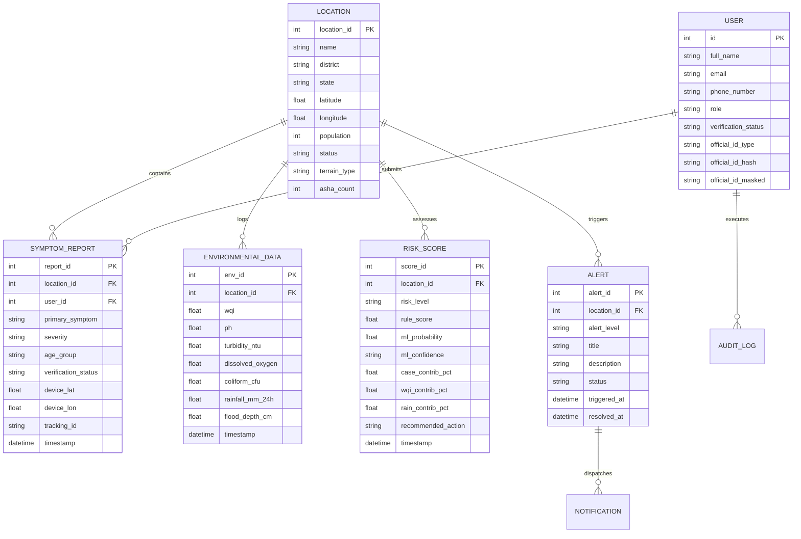

# AERIS — System Architecture & Design Specification

> **AI-Powered Epidemic Risk Intelligence & Early Warning System for Water-Borne Diseases in Rural Northeast India**  
> *"A risk signal is a prompt to verify, not a confirmed outbreak."*

---

## 1. High-Level System Architecture

AERIS is designed from the ground up for high-trust epidemiological surveillance across complex, remote, flood-prone terrain in Northeast India. It couples deterministic clinical rules with an interpretable machine-learning layer, secured by mathematical anti-fake validation.

```mermaid
flowchart TD
    subgraph DataCollection["Data Ingestion Layer"]
        A1["Frontline ASHA Field Reports\n(PWA + Offline Queue)"]
        A2["Hydrological & Weather Telemetry\n(IMD / CWC / Remote Sensing)"]
        A3["Water Quality Telemetry (WQI)\n(pH, Turbidity, Coliform, TDS)"]
    end

    subgraph SecurityGate["Anti-Fake & Verification Gate"]
        B1["Dihedral D5 Verhoeff Checksum\n(Aadhaar/PAN/Voter/DL Format)"]
        B2["Salted SHA-256 Hashing\n(Zero Plain-text Storage)"]
        B3["Haversine 15km Geofence Check"]
        B4["24h Duplicate Suppression"]
    end

    subgraph RiskIntelligence["Dual-Engine Risk Intelligence"]
        C1["Authoritative Deterministic Rules\n(Public Health Clinical Thresholds)"]
        C2["Scikit-Learn Logistic Classifier\n(Calibrated Outbreak Probability)"]
        C3["Rolling Z-Score Anomaly Detector\n(Syndromic Velocity Velocity)"]
    end

    subgraph DecisionSupport["Explainability & Rapid Response"]
        D1["Signal Attribution Breakdown\n(Cases, WQI, Rain, Velocity)"]
        D2["Actionable Verification Checklist\n(For Rapid Response Teams)"]
        D3["Real-time WebSocket & SSE Bus"]
    end

    subgraph Presentation["Client Presentation Tier"]
        E1["React 18 + MapLibre GL 3D Map"]
        E2["3-Mode Switcher\n(Light / Dark / High-Contrast)"]
        E3["Trilingual i18n\n(English / Hindi / Assamese)"]
    end

    DataCollection --> SecurityGate
    SecurityGate --> RiskIntelligence
    RiskIntelligence --> DecisionSupport
    DecisionSupport --> Presentation
```

---

## 2. Core Subsystems

### 2.1 The Dual-Engine Risk Scoring Framework

Traditional black-box neural networks are dangerous in public health because they produce unexplainable scores that health officers cannot legally or ethically act upon. Conversely, static heuristics lack predictive sensitivity. AERIS solves this via a **Dual-Engine Architecture**:

1. **Deterministic Public Health Rule Engine (Authoritative):**
   - **HIGH Risk:** Triggered when `7-day Cases > 15` AND `Water Quality Index (WQI) < 50` AND `7-day Rainfall > 400 mm`. Automatically generates a Level-1 Rapid Response Alert.
   - **MEDIUM Risk:** Triggered when `7-day Cases > 8` OR `WQI < 60`. Generates an Amber Advisory.
   - **LOW Risk:** Routine baseline surveillance.

2. **Scikit-Learn Logistic Regression Classifier (Supporting Probability):**
   - Trained on multi-season epidemiological datasets incorporating case velocity, non-linear water contamination gradients, and cumulative precipitation.
   - Produces a calibrated `0% to 100%` outbreak probability alongside an epistemic confidence rating (`High`, `Moderate`, `Low`).

3. **Rolling Z-Score Anomaly Velocity Detector:**
   - Detects sudden surges that violate local historical moving averages, catching localized micro-outbreaks before macro thresholds are breached.

4. **Factor Attribution Weights:**
   - Risk is transparently partitioned into 4 visible contribution percentages:
     $$\text{Total Risk} = W_{\text{cases}} + W_{\text{WQI}} + W_{\text{rainfall}} + W_{\text{velocity}}$$
   - Health officers can immediately see whether an alert is driven by dirty water, a sudden symptom spike, or upstream monsoon flooding.

---

### 2.2 Anti-Fake Telemetry & Ground-Truth Assurance

False or fabricated reports can cause panic or waste scarce medical inventory in rural areas. AERIS incorporates military-grade trust mechanisms:

1. **Dihedral Group D5 Verhoeff Algorithm:**
   - Client and server implement authentic Verhoeff checksum validation for 12-digit Indian Aadhaar numbers, catching 100% of single-digit errors and 100% of adjacent transposition errors.
2. **Salted Non-Reversible SHA-256 Storage:**
   - National identification numbers are **never** stored in plain text. A server-side cryptographically secure salt is prepended, hashed with SHA-256, and only the masked representation (`XXXX-XXXX-1234`) is rendered to operators.
3. **Haversine Geofencing:**
   - When a field worker submits a report with device GPS coordinates, the system calculates the great-circle Haversine distance to the reported village center. If the discrepancy exceeds 15 km, the report is flagged for fraud investigation.
4. **Duplicate Suppression:**
   - Submissions from the same device or identity claiming identical symptoms in the same village within a 24-hour window are clustered rather than double-counted.

---

### 2.3 Offline-First Progressive Web App (PWA)

In rural Northeast India (e.g., Majuli river island, Dima Hasao hills), cellular connectivity is intermittent.

- **IndexedDB Storage:** Field reports logged by ASHA workers are stored locally in IndexedDB when offline.
- **Service Worker Shell:** Static assets, brand logos, and UI components are precached in CacheStorage.
- **Background Auto-Sync:** As soon as network connectivity is re-established, the offline queue drains automatically with idempotent HTTP POST requests.

---

## 3. Database Entity-Relationship Model

---

## 4. UI & Theme Token Architecture

The design system strictly adheres to the official Sentinel Color Palette (`reference/Screenshot 2026-10-21 235300.png`):

| Variable | Token Name | Hex Code | Semantic Role |
|---|---|---|---|
| `--forest` | Primary Dark | `#102F15` | App frame, sidebar, typography, dark headers |
| `--emerald` | Primary Accent | `#339966` | Primary action buttons, active tabs, Low risk |
| `--mint` | Secondary Accent | `#66CC99` | Feature cards, icons, trend highlights |
| `--soft-mint` | Light Tint | `#D3FEEA` | Selected items, subtle highlight fills |
| `--pale-green` | Background | `#EBFADC` | Global light background, warm paper tone |
| `--pale-lime` | Highlight | `#EAF1B1` | Badges, callouts, ecological indicators |
| `--white` | Card Surface | `#FFFFFF` | Card surfaces and elevation containers |

**Accessibility Exceptions (Semantic Alerts only):**
- **High Risk:** `#DC2626` (Red-600) with warning shield icon and text label.
- **Medium Risk:** `#D97706` (Amber-600) with alert triangle and text label.
- **Low Risk:** `#339966` (`--emerald`) with check circle and text label.
